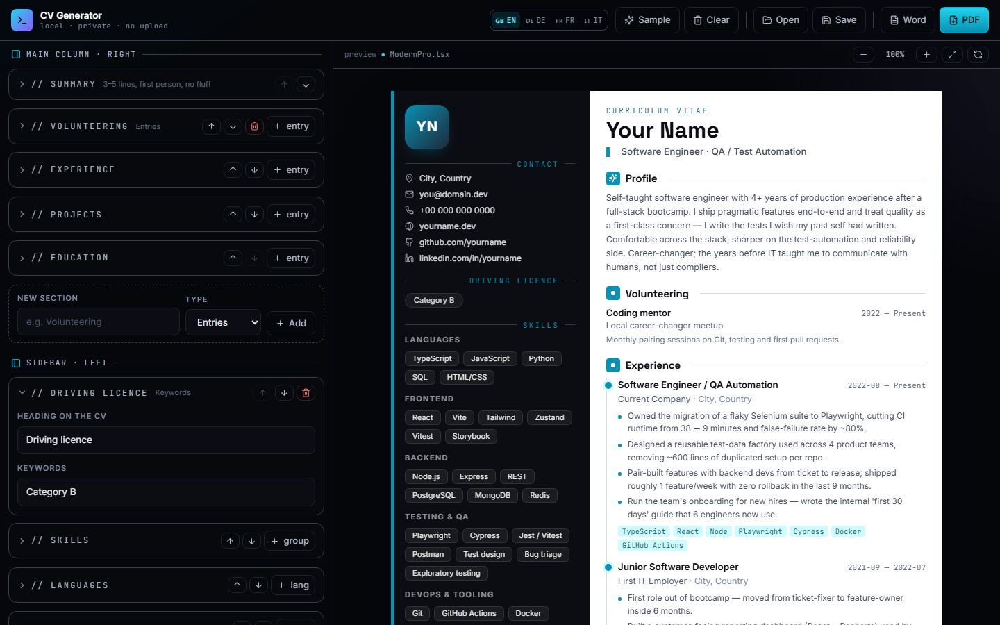

# CV Generator

[](https://github.com/RetoSchneider/CV-Generator/actions/workflows/ci.yml)

A browser-based CV editor with a live preview, PDF and Word export, and an English, German, French and Italian interface. Everything runs in the browser. There is no backend and no upload.

**[Try it live](https://retoschneider.github.io/CV-Generator/)**


## Features

- Live A4 preview while you type, with a sample CV in each of the four languages
- Sections are grouped into the main column and the sidebar and can be reordered within their column; name and contact details stay at the top
- Every section heading can be renamed, and the document title above the name is editable ("Curriculum Vitae" by default)
- Custom sections in either column, as free text, keywords or dated entries
- PDF export through the browser's print dialog, with selectable text and A4 pages on which the sidebar and main column break independently
- Word (.docx) export as a plain text document for applicant tracking systems, with the main column first and the sidebar after it
- Save and open your CV as a `.cvdata.json` file, validated before anything is replaced
- Photo upload, resized to 900 px and stored as JPEG



## Run locally

Requires Node.js 22.13 or later.

```sh
npm ci
npm run dev
```

The app runs at http://localhost:5173.

For the PDF export, choose A4, 100 % scale and no headers or footers in the print dialog. Chrome and Edge give the most reliable result.

## Tests

| Layer    | Location                 | Tool                       | What it checks                                                                                                                                                                                                      |
| -------- | ------------------------ | -------------------------- | ------------------------------------------------------------------------------------------------------------------------------------------------------------------------------------------------------------------- |
| Unit     | `tests/unit`             | Vitest                     | File and storage validation, ID repair, photo restrictions, overwrite detection, store actions, section order and custom sections, pagination, Word output in all four languages                                    |
| UI flows | `tests/e2e`              | Playwright Test (Chromium) | Editing and reload, language switch, moving and renaming sections, custom sections, clearing, photo upload and removal, save/open round trip, invalid files, keyboard-safe dialogs, blocked storage, failed exports |
| PDF      | `scripts/verify-pdf.mjs` | Playwright, PDF.js, Chrome | The real PDF: selectable text, every text block exactly once across pages, reordered and custom sections, Unicode, page count, links and print dialog cleanup                                                       |

```sh
npm run typecheck
npm test
npx playwright install chromium
npm run test:e2e
npm run test:pdf
```

`test:e2e` builds the production bundle and serves it before the tests run. `test:report` opens the HTML report. `test:pdf` needs Google Chrome, or `CHROME_PATH` pointing to a Chromium executable, and uses generated sample data only.

CI runs all of the above on every pull request and push to `master`, and deploys the app to GitHub Pages from `master` once every check has passed.

## Data and privacy

- Your CV stays in this browser's `localStorage` and is never sent to a server.
- **Save** downloads a `.cvdata.json` file including the photo. Keep it as a backup, because clearing the browser's site data also removes the stored CV.
- **Open** rejects files that are not CV data, unsupported versions, files over 10 MiB and photos that are not embedded PNG or JPEG.
- If the browser blocks storage, a warning appears and you can keep editing and save a backup file.

## Project structure

| Location                                 | Responsibility                                                     |
| ---------------------------------------- | ------------------------------------------------------------------ |
| `src/types.ts`                           | CV model                                                           |
| `src/data/`                              | Validation, defaults, section layout, sample data, browser storage |
| `src/store.ts`                           | Document state and persistence                                     |
| `src/components/forms/`                  | One editor section per file, column groups and custom sections     |
| `src/components/templates/ModernPro.tsx` | CV preview                                                         |
| `src/utils/`                             | Section placement, data files, PDF and Word export, pagination     |

## Tech stack

React 18, TypeScript, Vite, Tailwind CSS, Zustand, docx, Vitest, Playwright, PDF.js and GitHub Actions.

## License

[MIT](LICENSE)
