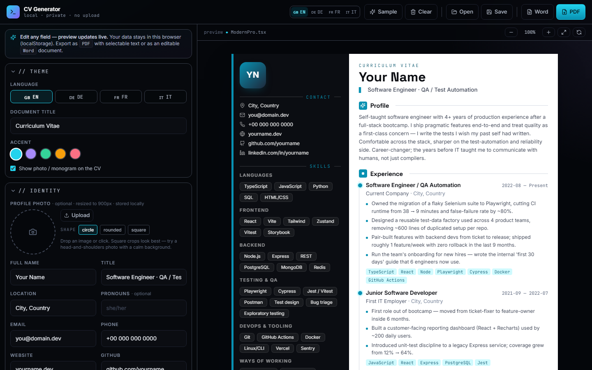

# CV Generator

[](https://github.com/RetoSchneider/CV-Generator/actions/workflows/ci.yml)

A browser-based CV editor with a live preview, PDF and Word export, and an English, German, French and Italian interface. Everything runs in the browser. There is no backend and no upload.

**[Try it live](https://retoschneider.github.io/CV-Generator/)**



## Features

- Live preview while you type
- Sections are grouped by column (main column on the right, sidebar on the left) and can be reordered within it; the preview, PDF and Word export follow the same order
- Section headings can be renamed, and you can add your own sections (text, keywords or entries) to either column
- Editable document title above the name, "Curriculum Vitae" by default
- PDF export through the browser's print dialog, with selectable text and A4 pages where the sidebar and main column break independently
- Word (.docx) export as a simple text document for applicant tracking systems
- Save and open your CV as a `.cvdata.json` file, with validation before anything is replaced
- Photo upload, resized to 900 px and stored as JPEG

## Run locally

Requires Node.js 22.13 or later.

```sh
npm ci
npm run dev
```

The app runs at http://localhost:5173.

## Tests

| Layer    | Location                 | Tool                           | What it checks                                                                                                                                       |
| -------- | ------------------------ | ------------------------------ | ---------------------------------------------------------------------------------------------------------------------------------------------------- |
| Unit     | `tests/unit`             | Vitest                         | File and storage validation, ID repair, photo restrictions, overwrite detection, store actions, pagination, Word output in all four languages        |
| UI flows | `tests/e2e`              | Playwright Test (Chromium)     | Editing and reload, language switch, photo upload and removal, save/open round trip, invalid files, keyboard-safe dialogs, blocked storage, failed exports |
| PDF      | `scripts/verify-pdf.mjs` | Playwright, PDF.js, Chrome     | The real PDF: selectable text, every text block exactly once across pages, Unicode, page count, links, and print dialog cleanup                      |

```sh
npm run typecheck
npm test
npx playwright install chromium
npm run test:e2e
npm run test:pdf
```

`test:e2e` builds the production bundle and serves it before the tests run. `test:report` opens the HTML report. `test:pdf` needs Google Chrome, or `CHROME_PATH` pointing to a Chromium executable, and uses generated sample data only.

CI runs all of the above on every pull request and push to `master`, and deploys the app to GitHub Pages from `master`.

## Data and privacy

- Your CV is kept in this browser's `localStorage`. Nothing is sent to a server.
- **Save** downloads a `.cvdata.json` file including the photo. **Open** rejects files that are not CV data, unsupported versions, files over 10 MiB and photos that are not embedded PNG or JPEG.
- If the browser blocks storage, a warning appears and you can keep editing and save a backup file.

## Known limitations

- Clearing the browser's site data deletes the CV. Use **Save** to keep a backup.
- There is one CV template. The Word export does not copy the two-column layout.
- PDF export uses the browser's print dialog and works best in Chrome or Edge. Choose A4, 100 % scale and no headers or footers.
- The editor is built for desktop screens.
- Fonts load from Google Fonts. Without a connection the app falls back to system fonts.
- UI tests run in Chromium only.

## Project structure

| Location                                 | Responsibility                                       |
| ---------------------------------------- | ---------------------------------------------------- |
| `src/types.ts`                           | CV model                                             |
| `src/data/`                              | Validation, defaults, sample data, browser storage   |
| `src/store.ts`                           | Document state and persistence                       |
| `src/components/forms/`                  | One editor section per file                          |
| `src/components/templates/ModernPro.tsx` | CV preview                                           |
| `src/utils/`                             | Data files, PDF and Word export, pagination          |

## How it was built

I built this project with the help of AI coding assistants. I set the scope and the test approach, and reviewed the changes.

## License

[MIT](LICENSE)
